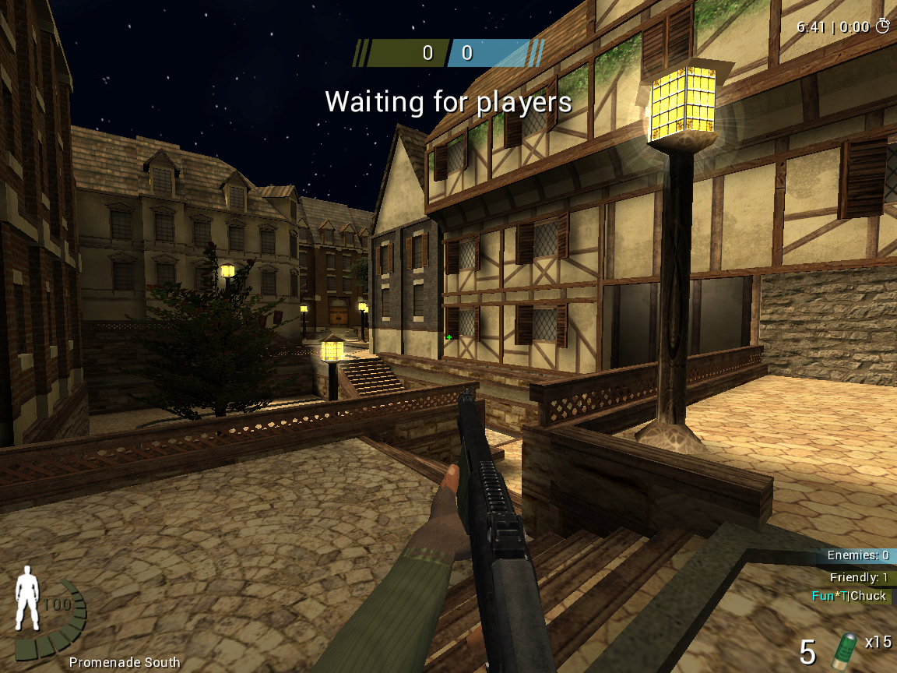
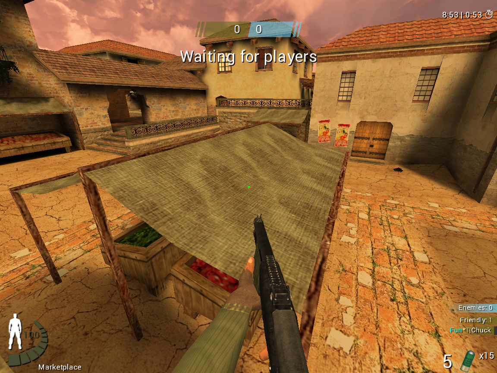
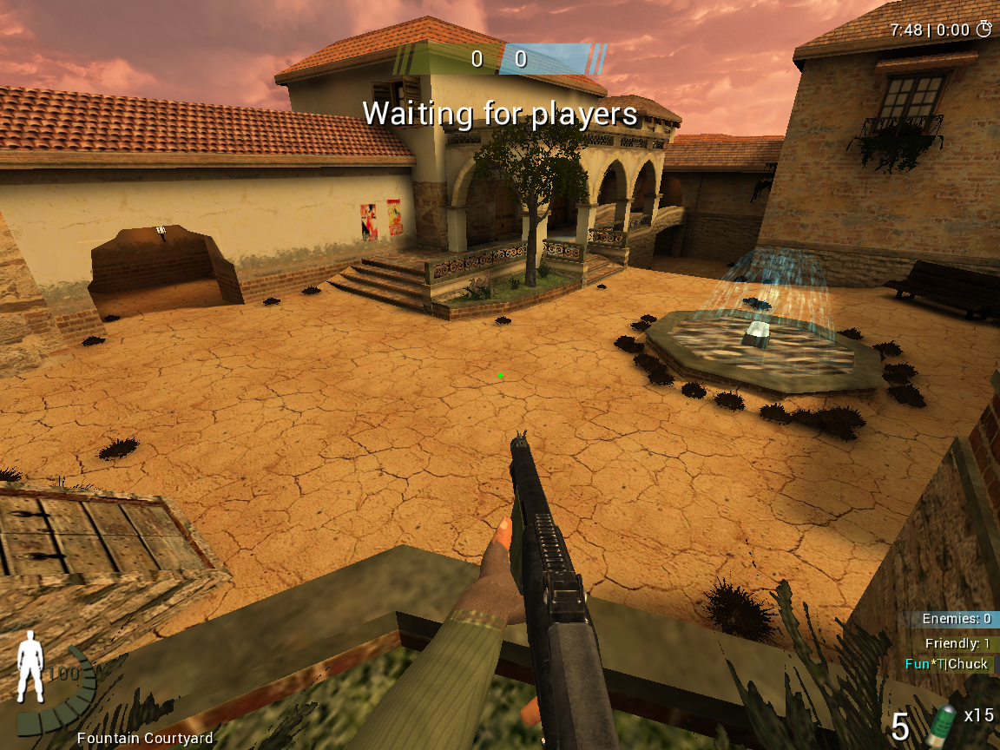
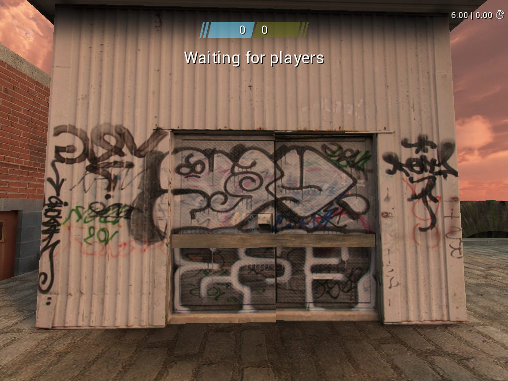
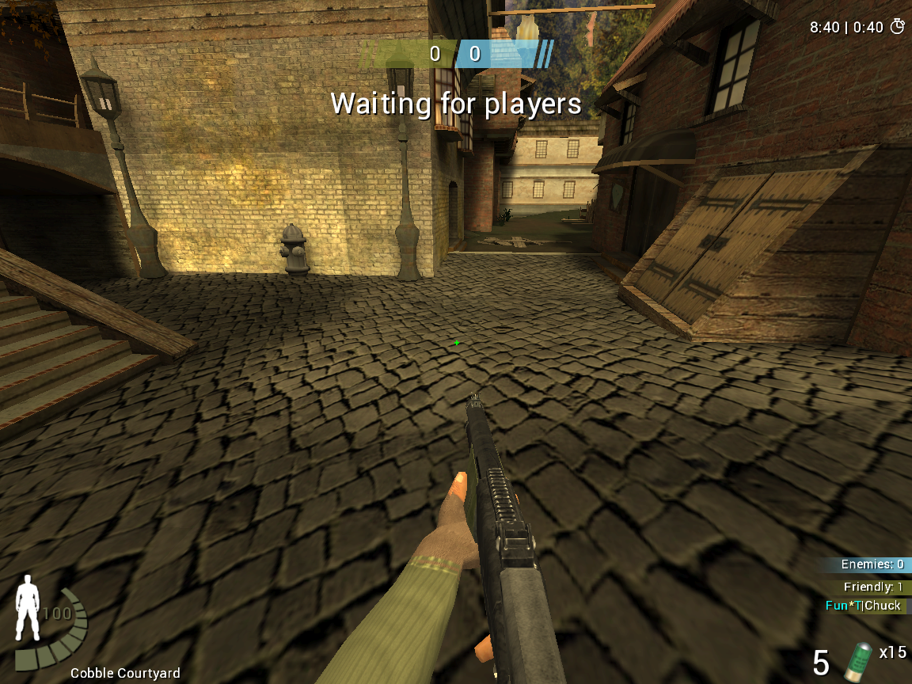

# Quake3e-Chuck (Custom Visual Build)

A customized fork of [rorgoroth/Quake3e-UrbanTerror](https://github.com/rorgoroth/Quake3e-UrbanTerror) tailored for **Urban Terror 4.3.4**. This build enhances visual clarity, texture relief, shadow smoothness, and brightness consistency across Linux and Windows without altering game rules or requiring external shaders.

## Key Modifications

### 1. 4x Bicubic Lightmap Upscaling (`tr_bsp.c`)
* Implemented **`R_UpscaleLightmap4x`** using Catmull-Rom / Cubic Hermite interpolation (`CubicHermite`) to upscale map lightmaps by 4x at load time.
* Eliminates blocky/pixelated shadow edges on walls and floors while disabling lightmap merging (`r_mergeLightmaps`) so every lightmap benefits from smooth gradients.

### 2. CPU-Side Bump Relief & Texture Sharpening (`tr_image.c`)
* Added **`R_ApplyBumpAndSharpen`** during texture upload (`Upload32`), combining a subtle 3D diagonal luminance bevel (bump relief) with a crisp sharpening pass.
* Enhances surface readability and depth perception on older hardware (including OpenGL-only GPUs without Vulkan).

### 3. Smart Decal & Blend Texture Protection (`R_IsDecalTexture`)
* Implemented **`R_IsDecalTexture`** to automatically detect alpha-channeled textures and blend decals (checking transparency and neutral `0`, `128`, or `255` corner backgrounds used by `add`, `filter`, and `2x` blend modes).
* Prevents decals, bullet holes, stains, and transparent overlays from getting square artifacts or washed-out colors during sharpening and light-scaling passes.

### 4. Window-Manager-Safe Brightness & Overbright (`tr_image.c`)
* Forced internal software overbright lighting (`tr.overbrightBits = 1`) and fixed texture intensity scaling (`1.3x`) while disabling hardware X11/SDL gamma ramp overrides (`applyGamma = qfalse`).
* Prevents the screen from darkening when switching virtual workspaces or Alt-Tabbing in tiling window managers (such as **i3wm**) or windowed/borderless modes.

### 5. Natural Map Lighting Preservation (`tr_bsp.c` & `tr_shader.c`)
* Disabled forced `vertexLight` collapsing so maps with complex `blendFunc filter` shaders (such as `ut4_tohunga_b8`, `ut4_casa`, and `ut4_prague`) preserve their intended color harmony and natural lighting.

---

## Installation & Usage

### Linux (`x86_64`)
1. Download `quake3e.x64` from the [Releases](../../releases) page (or build it from source).
2. Copy the binary into your Urban Terror installation directory (next to `q3ut4/`).
3. Make it executable and launch:
   ```bash
   chmod +x quake3e.x64
   ./quake3e.x64
   ```

### Windows (`x86_64`)
1. Download `quake3e.x64.exe` from the [Releases](../../releases) page.
2. Place `quake3e.x64.exe` inside your Urban Terror folder (next to `Quake3-UrT.exe` and `q3ut4/`).
3. Run `quake3e.x64.exe` directly — all required libraries (including static `libcurl` for fast HTTP map downloads) are built into the standalone executable.

---

## Recommended `autoexec.cfg` Settings

To get the sharpest textures, smooth trilinear filtering, and best visual fidelity from the custom bump/sharpen and lightmap upscaling passes, add these lines to your `q3ut4/autoexec.cfg`:

```cfg
seta r_picmip "0"
seta r_texturemode "GL_LINEAR_MIPMAP_LINEAR"
seta r_detailtextures "1"
seta r_neatsky "1"
```

---

## Building from Source (Arch Linux)

### Dependencies
```bash
sudo pacman -S --needed base-devel git sdl2 curl openal mesa libx11 libxext libxrandr libxxf86vm
```

### Build for Linux
```bash
make USE_SDL=1 -j$(nproc)
```
Output binary: `build/release-linux-x86_64/quake3e.x64`

### Cross-Compile to make a Windows 64-bit binary (`MinGW-w64`)
Install the cross-compiler:
```bash
sudo pacman -S --needed mingw-w64-gcc
```
Build the standalone Windows executable:
```bash
make PLATFORM=mingw32 ARCH=x86_64 USE_CURL=1 -j$(nproc)
```
Output binary: `build/release-mingw32-x86_64/quake3e.x64.exe`

---

## Screenshots

| Night (`ut4_austria`) | Casa mkt (`ut4_casa`) |
| :---: | :---: |
|  |  |
|:---: | :---: |
| Casa Fount  (`ut4_casa`) | Derelict (`ut4_casa`) | 
|  |  |
|:---: | :---: |
| Tohunga (`ut4_tohunga_b8`)
|  |
|

## Credits & License
* Upstream Urban Terror fork: [rorgoroth/Quake3e-UrbanTerror](https://github.com)
* Base engine: [ec-/Quake3e](https://github.com)
* Licensed under the **GNU General Public License v2.0 (GPLv2)** — see `COPYING.txt` for details.
